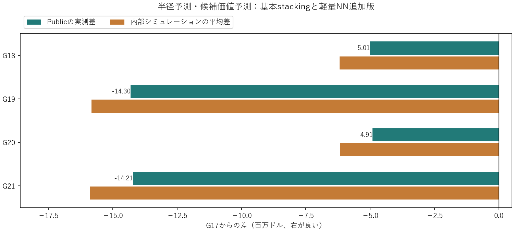

# パイプごとの施工円を学習するstacking：2方式と軽量NN追加版

結論：今回の4案はいずれもG17のPublic 79,168,928.88ドルを下回ったため、既存ベストを維持する。軽量NNと近似カーネルを追加すると両方式のPublicは小幅に改善したが、既存の幾何最適化・修理順を上回る結果にはならなかった。

|構成|ユーザー案：パイプごとの半径予測|Codex案：円候補の価値予測と更新|
|---|---:|---:|
|基本3モデル|G18：74,154,677.12|G19：64,870,357.55|
|NN＋近似カーネル追加|G20：74,260,900.63|G21：64,958,612.21|

- G20はG18から+106,223.51ドル。
- G21はG19から+88,254.66ドル。

管・周辺166特徴、候補には20特徴を追加した186特徴を使用。基本はExtraTrees・HistGradientBoosting・RidgeのOOF stacking。追加はMLP（32→16、約5.9千／6.5千パラメータ、学習最大1万行）とNyström近似RBFカーネル64成分＋Ridge。NNとカーネルの同時追加なので、Public差をNN単独の効果とは断定しない。

評価用の北東地域を500mのバッファで学習地域から離して、局所的な教師値への予測を確認した。最終CSVは同じ24条件×128乱数の3,072シナリオでG17と比較。4案とも全シナリオで被覆・予算・期限を満たしたが、24条件すべてで平均スコアがG17より低かった。両手法を比較提出するというユーザー承認に従い、全案を提出した。

教師値は「いま施工する／3年後に単管で施工する」という局所的な近似費用から作ったもので、最適計画の実測正解ではない。今回の結果は、局所的な近似精度の改善が、地表費・重複・年次予算・将来漏水を含む全体計画の改善には直結しないことを示す。改善を続けるなら、完成計画の総費用差を教師にする設計を検討する。

[基本stackingの実装・内部値・公式内訳](round5/README.ja.md) / [軽量モデル追加版](round6/README.ja.md)

生成コードは元の作業フォルダの既存ソース・入力予測スナップショットを参照する。CSVと学習済みモデルは保存済みだが、コードの再実行にはその作業フォルダ構成が必要。
