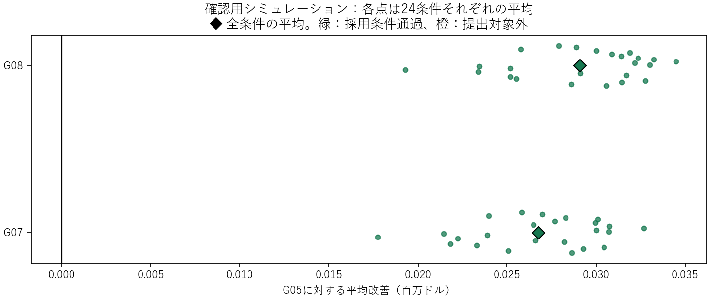

# G05を基準にした、大きな施工円の比較

Public最高は **G08の79,168,805.32ドル**。G05から17,992.74ドル、G04から177,837.07ドル改善した。内部評価の採用条件も通過したため、現時点の最終提出候補をG08へ更新する。

## 公式提出結果

|候補|Public score（ドル）|G05からの改善|
|---|---:|---:|
|G04|78,990,968.25|−159,844.33|
|G05|79,150,812.58|0.00|
|G06|79,150,351.83|−460.75|
|G08|79,168,805.32|+17,992.74|
|G07|79,167,182.01|+16,369.43|

G08とG07の修理費合計は同じ31,128,534.04ドル。両者の差1,623.31ドルは工事費の差だった。G08のG05に対する改善は工事費13,369.96ドル＋修理費4,622.78ドル。年次内訳は提出サイトの公式出力から保存した。

## 今回変えたこと

探索する近隣の距離を250・350・500mへ広げ、最大24円・64管までを候補にした。これは探索の計算上限で、大きい円を必ず使う指定ではない。実際の半径は対象管の両端を覆える位置から計算し、地表費が安くなる中心を探した。密度・管の長さ・地表の組合せによって、採用する統合数は場所ごとに変わる。

G07〜G09は同じ予定年内の統合。G10・G11は予定年が1年・2年違う近隣円も調べた。後者は、工事費の節約に「前倒しで防げる修理費」を加え、「自然な漏水交換で工事が不要になる機会の損失」を差し引く。G12はさらに、2種類の予測の両方で局所的な期待費用が下がる統合だけを採った。最終的な年次予算のずれは、計画全体のシミュレーションで評価した。

## 内部評価の採用条件

比較元をG05に固定し、2種類の漏水・修理費予測、漏水率3段階、修理費のばらつき2段階、地域内の漏水相関2段階の24条件を使った。開発用48乱数/条件を通った候補だけ、別の128乱数/条件（計3,072シナリオ）で確認した。

採用には、24条件すべての平均改善が正、全シナリオで被覆・予算・期限を満たすこと、さらに2つの予測系統それぞれで平均改善のモンテカルロ95%区間の下限が正、を両方の乱数群で要求した。乱数による区間であり、実際のPrivateスコアの保証ではない。

|候補|探索範囲 / 年差|実際の統合数|新統合円の最大半径|確認群の平均改善 vs G05|24条件中の最悪の平均改善|採用|
|---|---|---|---:|---:|---:|---|
|G07_wider250|250m / 0年|2〜5（範囲）|33.36m|+26,750.85ドル|+17,737.21ドル|採用|
|G08_adaptive350|350m / 0年|2〜6（範囲）|33.36m|+29,092.05ドル|+19,291.46ドル|採用|
|G10_neighbor_year350|350m / 1年|2〜12（範囲）|74.71m|未確認|開発群で不通過|提出対象外|
|G11_neighbor_year500|500m / 2年|2〜23（範囲）|74.71m|未確認|開発群で不通過|提出対象外|
|G12_robust_year500|500m / 2年|2〜16（範囲）|74.71m|未確認|開発群で不通過|提出対象外|

G09_adaptive500はG08_adaptive350とCSVのSHA256が完全一致。同じ計画なので重複提出しない。

## 提出ファイル

- [G08_adaptive350](submit/G08_adaptive350.csv)：内部評価の採用条件を通過。
- [G07_wider250](submit/G07_wider250.csv)：内部評価の採用条件を通過。

## 結果の解釈

大きな円が有利かどうかは、地表費の増加と小円を無料でスキップできる機会の減少で決まる。半径や統合数の上限を上げても、安い候補がなければ大きな円は採用しない。Publicの年間内訳は結果の記録にだけ使い、候補作成の漏水・費用予測には入れていない。

入力と計算は、`round2_protocol.json`、`round2_*_by_setting.csv`、各候補の`*_moves.json`・`*_report.json`、生成コードから確認できる。元データはチーム配布のpipes.csvとtrain.csv、予測は既存CMS001/F168を使用。

公式内訳：[G08](http://172.16.42.11:51238/static/output/Plxjzj67LjZYhTrIKJwaLeM8.txt) / [G07](http://172.16.42.11:51238/static/output/ysr21yEQwIJVyt_wksJdOUBY.txt)
