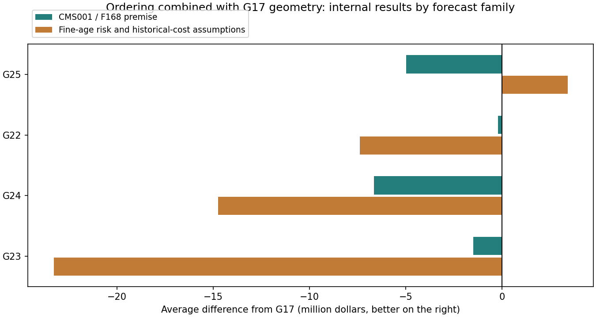

# Amy・Ryotaの順序 × G17の円配置

G17（Public 79,168,928.88ドル）の円を基に、既存の並び替えを組み合わせた4案を提出した。生成・検査・内部評価を終えてからCSVを固定し、公式結果を記録した。

|候補|順序の出典|Public score（ドル）|G17との差（ドル）|内部平均差（ドル）|平均改善した内部条件|
|---|---|---:|---:|---:|---:|
|G22|Ryota：3年累積リスクの固定順|78,027,592.07|-1,141,336.81|-3,797,439.91|4/24|
|G23|Ryota：初期3年の動的限界更新＋残りの固定順|75,121,482.83|-4,047,446.05|-12,387,402.55|0/24|
|G24|Amy：年間BCR＋累積鉄管長の進捗|72,497,399.23|-6,671,529.65|-10,697,844.85|0/24|
|G25|Amyの77.46M提出順を移植（Ryotaの順序を継承）|81,154,843.01|+1,985,914.13|-789,833.39|12/24|

## 組み合わせ方

G22〜G24は順序のルールだけを移植し、漏水予測はF168、条件付き修理費はCMS001に統一。過去のAmy/Ryotaの予測モデルを再学習した再現ではない。G25は保存済み77.46M提出CSVの管順を、新しい円の交換対象の最早順位に対応させた。複数管が同じ新しい円になる場合、最も早い管の位置にその円を置く。

順序を変えた後、各行で新たに交換する管を計算し、その両端を覆う条件で中心・半径・分割を再調整した。中心の探索は1バッチ最大384位置という共通の計算上限を設けた。次に、同じ予定年の近隣円を密度に応じて最大350mまで探索し、局所的な期待費用が下がる組だけを統合した。統合は計算上限16円・48管で、実際の統合数は場所ごとの費用で選択する。

円も再調整しているため、Public差は順序と円配置を組み合わせた計画全体の差であり、並び替えだけの因果効果ではない。

全案でG17と同じ交換対象の和集合を保つ。元の被覆円は末尾に残し、既にPUとなっているため無料で被覆条件を満たす。書き出したCSVを再読込して全鉄管の幾何カバー、1年1,000万ドルと繰越、2051年までの完了を確認した。

G24の元の方式は年間計画をCSV順序として連結する。提出CSVは予定年を直接指定できないため、予算が余れば次の予定年の行が実際には早く実行され得る。この点も含め、最終CSVを公式と同じ順次実行ルールで評価した。

## 出典と評価

Amyの77.46M統合カバー案はRyotaの順序を継承している。G24の別ルールはAmyの最新full-pipelineノートブックの経済工事フェーズと必須進捗フェーズから移植した。担当者名は順序の出典であり、施工円はTakito/CodexのG17系列を共通使用する。

[Ryotaの元コード](https://github.com/reinesana/STAT440-star-kingdom-project/blob/ca6cdae4b859782e7a30d543fce686a30d52354c/submissions/2026-10-28_ryota_early3/early_three_years.py) / [Amyの元ノートブック](https://github.com/reinesana/STAT440-star-kingdom-project/blob/ca6cdae4b859782e7a30d543fce686a30d52354c/notebooks/Amy_Sim/star_kingdom_full_pipeline_AS.ipynb)

内部評価はG17を比較元に、2つの予測系統×漏水率3段階×費用ばらつき2段階×地域内相関2段階の24条件、各128乱数＝3,072シナリオ。新しい共通乱数202611027702でペア比較した。内部キーG05はコードの参照腕名で、実際の比較元はG17。これらは既存予測を前提とした感度分析であり、実際のPrivateの保証ではない。

## 結論

今回のPublic最高はG25の81,154,843.01ドル。G17から+1,985,914.13ドル。内部値も併記し、Publicの改善と未知データでの優位を区別する。

公式内訳：[G22](http://172.16.42.11:51238/static/output/JkawAgpRDvoPDQswCsT3J1wI.txt)

公式内訳：[G23](http://172.16.42.11:51238/static/output/9fD4SPZN0dRKBlHYD4VJgvyw.txt)

公式内訳：[G24](http://172.16.42.11:51238/static/output/cJp0KBVmPN6YseRIM3sP_cSB.txt)

公式内訳：[G25](http://172.16.42.11:51238/static/output/kZOHn7zOjWemF_glE0gkDTih.txt)
